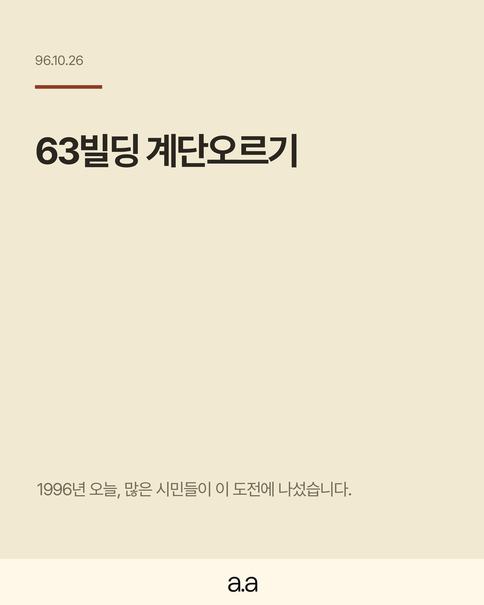
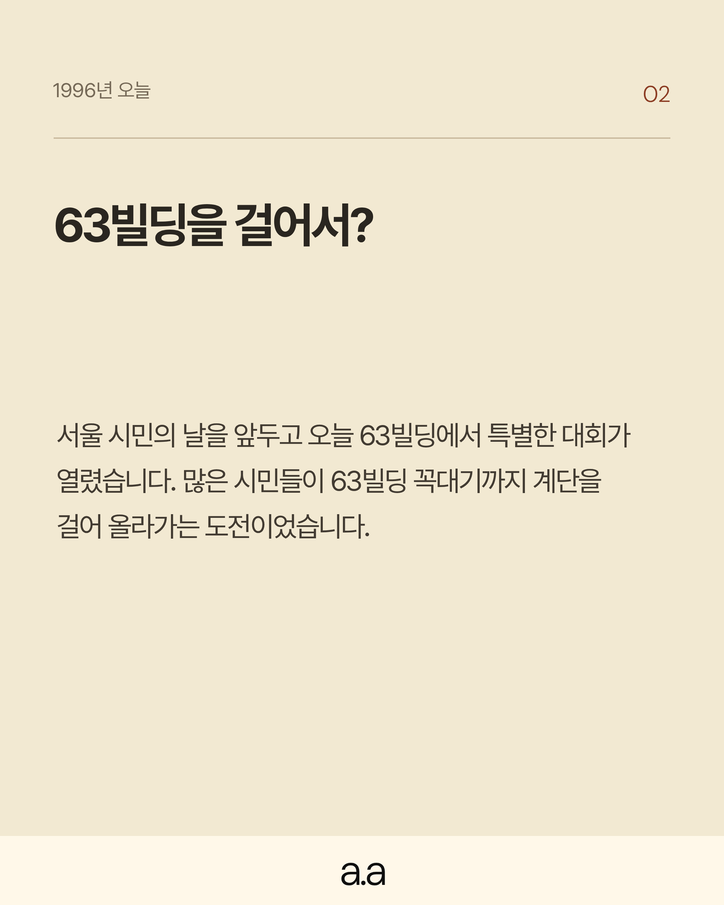
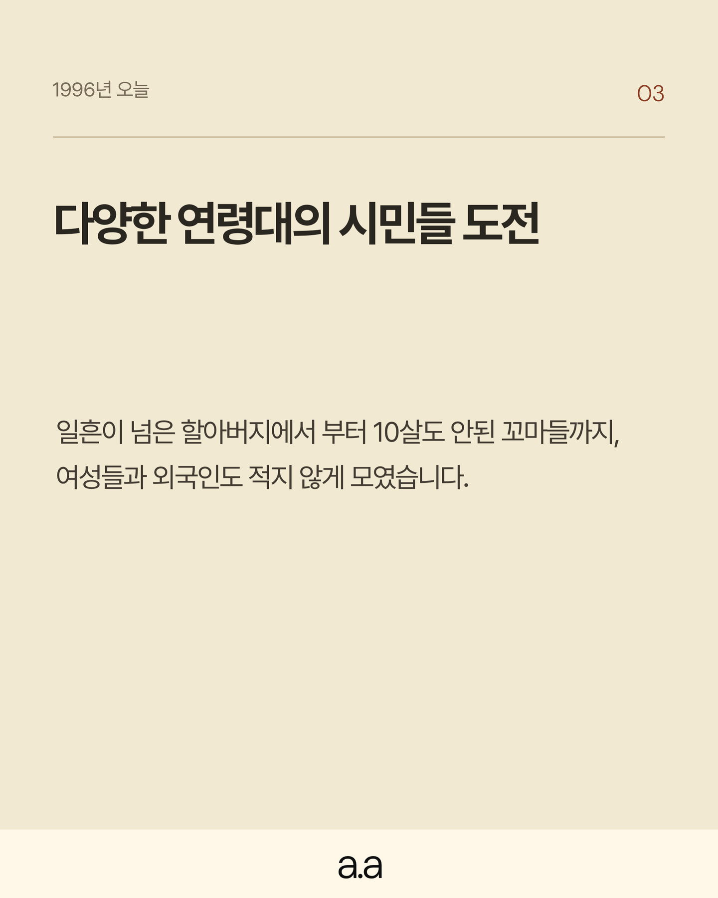
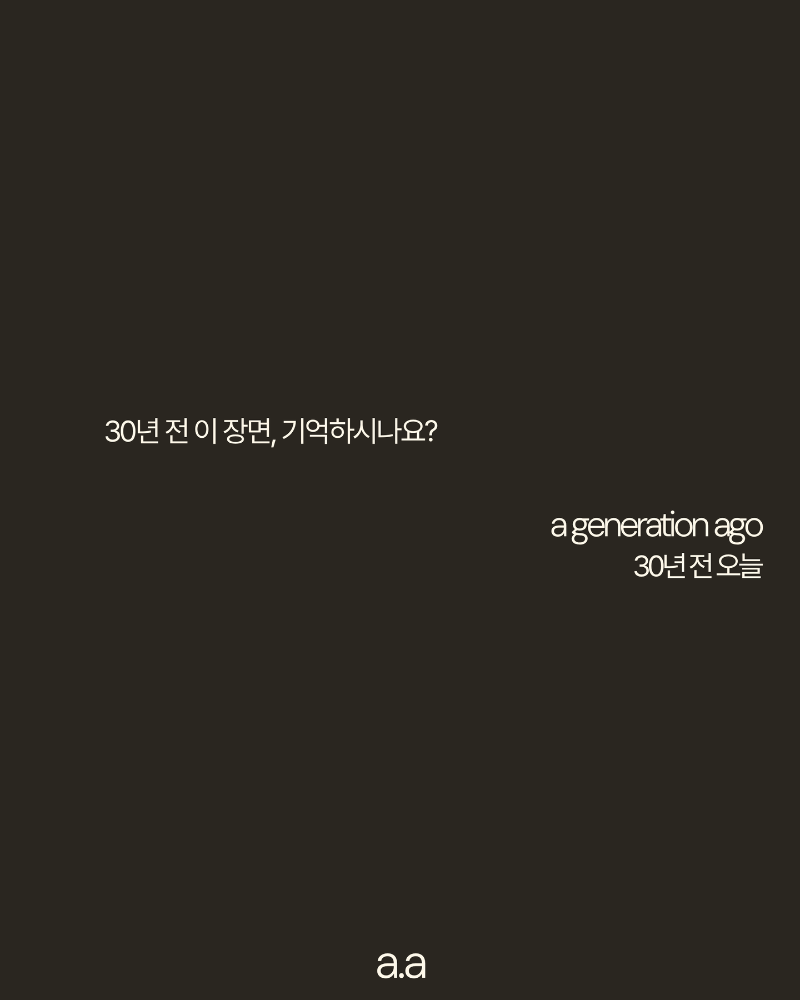
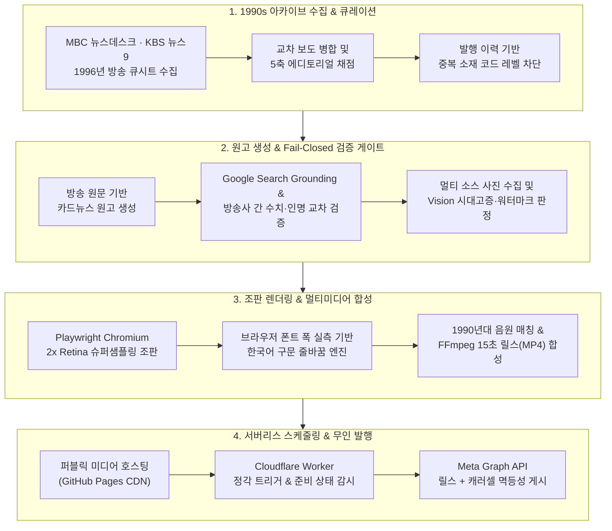

# a.a (a generation ago) — 30년 전 오늘 아카이브 미디어 파이프라인

> **"30년 전 오늘, 한국 사회는 어떤 장면을 지나고 있었을까?"**
>
> 1990년대 대한민국의 주요 뉴스와 시대적 순간을 매일 발굴해, 교차 팩트체크·시대고증 사진 검증·타이포그래피 조판·릴스(Reels) 영상 합성·인스타그램 게시까지 전 과정을 무인으로 수행하는 **자율형 미디어 퍼블리싱 시스템**입니다.

  
  
  
  

---

## 1. 프로젝트 개요 및 기획 의도

단순히 생성형 AI에게 "옛날 뉴스를 요약해 줘"라고 맡기면, 그럴듯하지만 실제로는 존재하지 않았던 날짜·수치(환각)를 지어내거나 시대에 맞지 않는 현대 사진을 가져오고, 모바일 화면에서 읽기 불편한 어색한 한국어 줄바꿈을 만들어냅니다.

이 프로젝트는 **"생성형 AI의 비결정성(Non-determinism)을 어떻게 제품 설계와 소프트웨어 엔지니어링으로 통제할 것인가"**라는 질문에서 출발했습니다. 서비스 기획과 에디토리얼 디렉션, Figma 기반 디자인 시스템(`a.a`) 설계, 파이프라인 아키텍처 정의, 그리고 반복되는 실패 원인을 코드 레벨의 검증 게이트로 전환하는 전 과정을 직접 주도하며 구축했습니다.

- **개발 및 운영 규모**: 400+ Commits / 68+ PRs / Python 프로덕션 모듈 36종(13,800+ Lines) & 오프라인 회귀 테스트 28종(180+ Unit Tests)
- **운영 비용**: **\$0 / 월** (무료 API 쿼터 예산 제어, 서버리스 엣지 스케줄러, 이원화 저장소 아키텍처를 결합해 유료 SaaS 없이 완전 무인 운영)
- **이 저장소(`30y-cards`)의 역할**: 보안과 실행 예산을 분리하기 위해 설계한 **이원화(Dual-Repository) 아키텍처의 퍼블릭 미디어 딜리버리 계층**입니다. 핵심 파이프라인 코드와 인증 정보는 비공개 코어 저장소에서 실행되며, 최종 검증을 통과한 카드 이미지(`PNG`)와 릴스 영상(`MP4`)만 이 저장소를 통해 호스팅 및 배포됩니다.

---

## 2. 시스템 아키텍처 (End-to-End Pipeline)

---

## 3. 직접 정의하고 해결한 핵심 엔지니어링 과제

### ① 프롬프트 의존에서 '결정적(Deterministic) 검증 코드'로의 전환
생성형 모델에게 프롬프트로만 규칙을 지시했을 때 발생하는 한계를 직접 분석하고, 핵심 품질 기준을 모두 코드 레벨의 **Fail-Closed 게이트**로 재설계했습니다.
- **아카이브 원문 기반 소재 발굴**: LLM의 기억에 의존하지 않고 1996년 방송사(KBS·MBC)의 실제 뉴스 큐시트와 기사 본문을 직접 수집·정규화하여, 양 방송사가 동시에 보도한 주요 사건에 가점을 부여하는 채점 구조를 설계했습니다.
- **교차 출처 팩트체크 게이트**: 같은 날 같은 사건이라도 방송사마다 세부 수치가 다를 수 있는 점(예: 두 기사의 참가자 수나 인물 표기 불일치)을 발견하고, 단일 출처가 뒷받침하는 사실은 살리되 명시적으로 충돌하는 수치는 카드에서 자동 배제하는 교차 검증 로직을 구현했습니다.
- **시대고증 비전(Vision) 게이트**: 검색 순위가 높은 이미지라고 해서 실제 1990년대 사진이라는 보장이 없으므로, AI 생성 이미지·현대 사진·뉴스 자막/워터마크가 박힌 썸네일을 사전 필터링한 뒤 배치(Batch) 비전 검증을 통과한 실사 사진만 채택하도록 구성했습니다.

### ② Figma 디자인 시스템(`a.a`) 직접 설계 및 한국어 구문 줄바꿈 엔진 구현
인스타그램 피드에서 매거진 수준의 가독성을 확보하기 위해 **Figma에서 직접 `a.a` 카드 디자인 시스템을 설계**하고, 디자인 의도가 자동화 환경에서도 1px의 오차 없이 재현되도록 렌더러를 구축했습니다.
- **픽셀 단위 타이포그래피 제어**: Chromium 환경에서 가변 폰트(`DM Sans`, `Pretendard`)의 광학 사이즈(`opsz`)가 두껍게 렌더링되는 문제를 찾아내어, 실제 Figma 출력물과 잉크 밴드를 대조하며 자간·행간·여백을 고정하고 2배수(`2160×2700`) 캡처 후 Lanczos 다운샘플링(`1440×1800`)을 적용했습니다.
- **브라우저 실측 기반 한국어 줄바꿈 엔진**: CSS 기본 줄바꿈(`word-break: keep-all`)이나 LLM의 임의 개행만으로는 한국어 수식어와 피수식어가 어색하게 끊어지는 문제를 해결하기 위해, 헤드리스 브라우저에서 각 어절의 실제 렌더링 픽셀 폭을 측정한 뒤 한국어 문장 성분에 맞춰 줄을 접는 전용 줄바꿈 엔진을 설계했습니다.

### ③ 무료 티어(\$0) 제약 조건을 돌파한 리소스·쿼터 엔지니어링
유료 API나 외부 유료 스케줄링 툴 없이 안정적인 일일 발행을 유지하기 위해 호출 구조와 인프라를 직접 최적화했습니다.
- **일일 API 호출 예산(Budget) 설계**: 소재 수집 단계의 LLM 호출을 0회로 줄이고, 사실 검증 시 이미 확보된 원문 출처 메타데이터를 보존해 불필요한 재검색 호출을 제거했습니다. 또한 주력 모델의 일일 무료 한도(HTTP 429 PerDay) 소진 시 별도 쿼터 버킷을 가진 경량 모델로 즉시 전환하는 자동 폴백(Failover) 구조를 도입했습니다.
- **서버리스 역할 분리 및 멱등성(Idempotency) 복구**: 비공개 저장소의 실행 시간을 아끼기 위해 정각 게시 트리거와 시간별 헬스체크는 Cloudflare Worker 엣지 크론으로 분리했습니다. 네트워크 일시 장애로 릴스만 올라가고 캐러셀이 실패한 경우에도, 재시도 시 기존 미디어 ID를 조회해 중복 게시 없이 누락된 포맷만 이어서 완료하는 상태 머신을 구축했습니다.

---

## 4. AI-Native 개발 워크플로 (Multi-Agent Orchestration)

이 프로젝트는 기획·아키텍처·디자인·검증 기준을 직접 수립한 위에서, 성격이 다른 여러 AI 코딩 에이전트(Claude Code, OpenAI Codex, Google Antigravity)를 적재적소에 지휘하며 완성도를 높인 **AI-Native 엔지니어링** 사례입니다.

1. **도메인 지식의 명문화 (Context Engineering)**
   - 에이전트가 바뀌거나 세션이 초기화되어도 디자인 수치, 사실 검증 정책, 배포 스케줄이 흔들리지 않도록 작업 영역별 설계 근거와 금지 사항을 모듈화된 지침으로 구조화했습니다.
2. **역할 기반 멀티 에이전트 활용**
   - **설계 및 시각 조판**: 초기 파이프라인 구조화, Figma 디자인 토큰 이식, 한국어 줄바꿈 알고리즘 구현
   - **엣지 케이스 하드닝 & CI 고도화**: PR 단위의 연속적인 예외 처리 보강, 상태 복구 로직 정교화 및 단위 테스트 확장
   - **복합 장애 진단 & 쿼터 최적화**: 스케줄러·웹훅·API 한도 간의 복합 병목 분석, 검증 파이프라인 호출 다이어트 및 멀티 모델 폴백 아키텍처 적용
3. **오프라인 회귀 테스트 하네스 (180+ Tests)**
   - AI와 협업해 빠르게 코드를 수정하더라도 기존 발행 규칙이나 디자인 레이아웃이 깨지지 않도록, 외부 네트워크 호출을 완전히 차단(Mock)한 28개 테스트 모듈로 모든 변경사항을 자동 검증합니다.

---

## 5. 기술 스택 (Tech Stack)

| 영역 | 사용 기술 |
|---|---|
| **Core & Pipeline** | Python 3.12, Requests, BeautifulSoup / HTML Parser, JSON Schema Repair |
| **AI & Verification** | Google Gemini API (`gemini-2.5-flash` / `flash-lite`), Google Search Grounding, Multimodal Vision Verification |
| **Design & Rendering** | Figma (`a.a` Design System), Playwright (Headless Chromium), Jinja2, Pillow (Lanczos Supersampling), Custom Korean Line-Break Engine |
| **Audio & Video** | FFmpeg / FFprobe, iTunes Search API (1990s Track Matching & 15s Reel Synthesis) |
| **Infra & Automation** | GitHub Actions (Dual-Repo CI/CD), Cloudflare Workers (Cron Triggers & Webhook Router), Meta Instagram Graph API, Telegram Bot API, Notion API |
